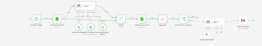
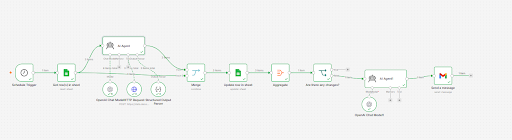

# Release Process: AI Competitor Pricing Monitoring

## Prototype Overview

The prototype is an n8n automation that checks competitor pricing pages on a schedule. It uses Decodo to collect web data and OpenAI to compare current prices with previous pricing stored in Google Sheets.

The workflow saves comparison results and sends a consolidated report through Gmail, helping users monitor pricing changes with less manual work.

### Original Workflow

## Change Description

An `IF` node was added to determine whether changes have been detected and an email notification should be sent.

The original goal was to notify the recipient only when competitor prices change. Reports stating that no changes were detected consume unnecessary resources.

The main AI Agent’s System Message was also updated. Both changes address the same problem: ensuring that notifications reflect detected changes.

### Previous System Message

You are a pricing analysis specialist. Your task is to scrape pricing pages and compare them with previous data and detect changes.

Use the scrape_as_markdown tool to get the webpage content, then analyze the pricing information. When scraping, use fullResponse option.

Focus specifically on:
1. All pricing plans available
2. Price changes from the previous data
3. Feature changes in each plan

Return only these 2 fields in valid JSON:
1.'pricing_summary' - A textual description of ALL current pricing plans, including plan names, prices, and top 5 features for each plan
2. 'differences_summary' - A concise summary of any price or feature differences compared to the previous pricing data. Focus only on actual changes in prices or major features.

-Be precise and only report clearly visible instruction

### Updated System Message

You are a pricing analysis specialist. Your task is to scrape pricing pages and compare them with previous data and detect changes.

Use the scrape_as_markdown tool to get the webpage content, then analyze the pricing information. When scraping, use fullResponse option.

Focus specifically on:
1. All pricing plans available
2. Price changes from the previous data
3. Feature changes in each plan

Return only these 2 fields in valid JSON:
1.'pricing_summary' - A textual description of all current pricing plans, including plan names, prices, and top 5 features for each plan
2. 'differences_summary' - A summary of all price or feature differences compared to the previous pricing data. Focus on every pricing change and features.

-if the page has changes in pricing or features, return the information for that exact page only with the new price or feature information. Do not list other features where there are no changes.

-Only then if Previous pricing and features are the same as now, return exactly 'No Changes'

-Be precise, read and analyze the previous and current information carefully and report clearly visible instruction

## Staging Environment

Testing was performed in n8n using a copy of the original workflow, keeping the original version available in case of errors.

A separate test spreadsheet was used.

Changes will be introduced into the original workflow only after successful testing and approval for release.

## Testing the New Condition

### Expected Behavior

The `IF` node checks whether all three competitors have a `Differences - Summary` value equal to `No Changes`.

The conditions are combined using `AND`:

- Exa: `Differences - Summary` equals `No Changes`.
- Tavily: `Differences - Summary` equals `No Changes`.
- SerpAPI: `Differences - Summary` equals `No Changes`.

| Condition | Branch | Expected Action |
| --- | --- | --- |
| All three competitors have exactly `No Changes` | `True` | End the workflow without generating or sending an email. |
| At least one competitor has a different summary | `False` | Generate and send an email report. |

### Scenario 1 — No Pricing Changes

**Actual result:** The workflow followed the original processing steps, with the new `IF` node placed before `AI Agent1`.

The prices of all three competitors remained unchanged, and each `Differences - Summary` field contained `No Changes`.

The workflow followed the `True` branch and ended without sending an email.

### Scenario 2 — Pricing Changes Detected

**Actual result:** Two competitors had prices that differed from the previously stored data.

The condition requiring all three summaries to equal `No Changes` evaluated to `False`.

The workflow followed the `False` branch, and `AI Agent1` prepared the Gmail report.

## Regression Testing

The six tests from task 4.2 were repeated to compare the original and updated workflows.

### Test Inputs and Expected Results

| Test ID | Input | Original Expected Result | Updated Expected Result |
| --- | --- | --- | --- |
| T01 | A Google Sheets record where the previous price matches the newly collected price. | `Differences - Summary` displays `No Changes`. | `Differences - Summary` displays `No Changes`. |
| T02 | The `Last updated` column header is renamed in Google Sheets. | The renamed column is not populated, but the workflow does not return an error. | The renamed column is not populated, but the workflow does not return an error. |
| T03 | Required output field names are defined in the Structured Output Parser but are not repeated in the AI Agent’s System Message. | The agent assigns information to the correct fields without reducing information quality. | The agent assigns information to the correct fields without reducing information quality. |
| T04 | The price format changes from `$10` to `$10.00`, without changing its numerical value. | The pricing information is updated, while `Differences - Summary` remains `No Changes`. | The pricing information is updated, while `Differences - Summary` remains `No Changes`. |
| T05 | The AI Agent’s pricing information is manually checked against the websites of Exa, Tavily, and SerpAPI. | The AI output and Google Sheets information match the websites. | The AI output and Google Sheets information match the websites. |
| T06 | The workflow is run when competitor prices match those stored in the spreadsheet. | No email is sent when prices remain unchanged; emails are sent only when changes are detected. | No email is sent when prices and product features remain unchanged; emails are sent only when changes are detected. |

### Actual Results Before and After the Changes

| Test ID | Original Actual Result | Original Test Passed? | Updated Actual Result | Updated Test Passed? |
| --- | --- | --- | --- | --- |
| T01 | The column displayed `No changes`. | Yes | The column displayed `No Changes`. | Yes |
| T02 | The corresponding cell remained empty. | Yes | The corresponding cell remained empty. | Yes |
| T03 | The agent populated the fields, but in two out of three runs, a record containing changed information was still marked `No Changes`. | Partially | Even with the revised prompt, the agent sometimes missed changes when the output field names were removed from the System Message. | Partially |
| T04 | The information was updated, and `Differences - Summary` remained `No Changes`. | Yes | The agent recognized that the numerical price was unchanged, and the summary remained `No Changes`. | Yes |
| T05 | The website information matched the AI output and Google Sheets records. | Yes | The website information matched the agent’s output. | Yes |
| T06 | An email was sent even when prices had not changed. A possible cause was the absence of an additional node controlling email delivery. | No | Emails were sent only when prices or features changed. When no changes were detected, no email was generated. | Yes |

### Test Summary

Of the six tests in the updated version:

- **5 passed**
- **1 partially passed**
- **0 failed**

The email notification issue identified in T06 was resolved.

T03 still revealed an unresolved issue with detecting changes when output field names were omitted from the System Message.

## Rollback Plan

If the new `IF` node fails or prevents emails from being sent when pricing changes have been detected, the process will be switched back to the previous version.

The previous version sends consolidated reports regardless of whether changes have been detected.

Improvements to the new version will continue in the test environment. Before another release attempt, the tests will be rerun, the release checklist will be completed, and email delivery will be checked for cases involving changes to product offerings.

Both the previous and updated workflow versions are available in n8n. Their schedules will not run simultaneously.

## Release Checklist

| Check | Status | Notes |
| --- | --- | --- |
| The updated workflow performs its core function. | Completed | The workflow reaches the end without execution errors. |
| Tests for the targeted issue have been run. | Completed | The tests addressing T06 passed. |
| Previous tests have been rerun. | Completed | Results remained unchanged except for T06. |
| An email is sent when a product offering changes. | Completed | The `IF` node routes execution through the `False` branch. |
| No critical issues have been found. | Requires assessment | T03 still contains an unresolved issue. |
| No email is generated or sent when the offering has not changed. | Completed | The workflow follows the `True` branch. |
| Required API access is available. | Completed | OpenAI and Decodo access is available. |
| API keys and access credentials are not visible in the publicly shared workflow. | Completed | They are stored in n8n Credentials rather than directly in the workflow. |
| Test spreadsheet column names match the original spreadsheet. | Completed | The names have not been changed. |
| Changes are made in a test copy rather than the original workflow. | Completed | A separate test version was created. |
| Changes to the test version have been documented. | Completed | The additional `IF` node and System Message updates are described. |
| A rollback plan has been prepared. | Completed | Return to the previous version while resolving issues. |
| A person has approved the release. | Not approved | Decision: make further corrections. |

## Release Decision

**Decision: Revise before release.**

Although the targeted issue was successfully resolved, further improvements are needed for issues identified in T03 and T02.

T02 matched its expected test result, but leaving a field empty without a warning is not the desired behavior for a reliable workflow.

A future improvement should notify the recipient when the dataset structure has been modified. The warning should explain that a renamed column may prevent data from being read correctly and ask the recipient to check the spreadsheet.

## Reflection

This approach supports repeatable reviews of a workflow or another process.

When making changes, it is easy to overlook existing problems or essential checks, especially in workflows with multiple branches.

A documented testing and release process helps identify which tests and checks must be completed before launch, reducing the risk of releasing an unfinished solution.
