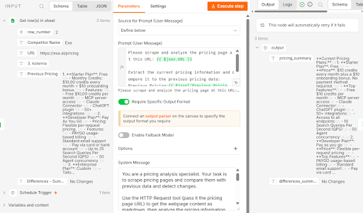
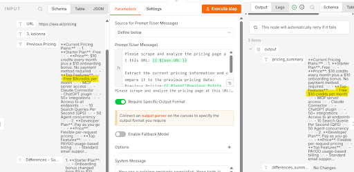

# Prototype Testing: AI Competitor Pricing Monitoring

## Tested Prototype

The tested prototype is an n8n automation that checks competitor pricing pages on a schedule. It uses Decodo to collect web data and OpenAI to compare current prices with previous pricing stored in Google Sheets.

The workflow saves the comparison results and sends a consolidated report through Gmail, helping users monitor pricing changes with less manual work.

## Test Cases

| Test ID | Input | Expected Result | Actual Result | Passed? | What Does the Test Check? |
| --- | --- | --- | --- | --- | --- |
| T01 | A Google Sheets record where the previous price matches the newly collected price; the result is checked in `Differences - Summary`. | The field displays `No Changes`. | The column displayed `No changes`. | Yes | Core functionality. |
| T02 | The `Last updated` column header is renamed in Google Sheets. | The renamed column is not populated, but the workflow does not return an error. | The corresponding cell remained empty. | Yes | Handling incomplete spreadsheet input and checking whether the system responds to a changed column header. |
| T03 | The required output field names are defined in the Structured Output Parser but are not repeated in the AI Agent’s System Message. | The AI Agent assigns information to the correct fields without reducing the quality of the information. | The agent populated the fields, but in two out of three runs, a record containing changed information was still marked `No Changes` in `Differences - Summary`. | Partially | AI output format and assignment of information to fields. |
| T04 | The price format changes from `$10` to `$10.00`, without changing its numerical value. | The pricing information is updated, while `Differences - Summary` continues to display `No Changes`. | The information was updated, and `Differences - Summary` displayed `No Changes`. | Yes | An edge case involving price normalization. |
| T05 | The AI Agent’s pricing information is manually checked against the websites of all three competitors: Exa, Tavily, and SerpAPI. | The AI Agent’s output and the information saved in Google Sheets match the information available on the websites. | The website information matched the AI Agent’s output and the Google Sheets records. | Yes | Human review and data accuracy. |
| T06 | The workflow is run when competitor prices match the prices already stored in the spreadsheet. | No email is sent when prices have not changed; emails are sent only when changes are detected. | An email was sent even though prices had not changed. A possible cause is the absence of an additional workflow node that determines when an email should be sent. | No | Workflow logic and email notification conditions. |

## Successful Test Example

### T04 — Price Format Normalization

The input shows a price of `$10.00`, while the output contains `$10`. The `differences_summary` field remains `No Changes`.

This is the expected result because the numerical price is unchanged; only its written format differs.

## Example of a Test That Revealed a Problem

### T03 — A Price Change Was Not Reported

The AI Agent’s input showed free credits worth `$9`, while the output changed this value to `$10`. However, `differences_summary` still reported `No Changes`.

One possible explanation is that the System Message did not provide detailed instructions for each output field, while the field names were defined only in the Structured Output Parser.

## What These Tests Help Verify

### T01 — Core Functionality

This test checks how the workflow operates, whether all steps execute, whether the spreadsheet is populated, and whether an email is sent.

### T02 — Incomplete Input and Spreadsheet Structure Changes

A user may accidentally modify data, delete a column, or change a column header. This test checks whether the workflow continues with an empty field or stops with a system error.

Because the system did not report the missing expected column, there is a risk that incomplete results could go unnoticed.

### T03 — The Effect of System Message Changes

This test checks whether changes to the AI Agent’s System Message affect its response, even when the instructions appear to repeat information already provided elsewhere.

The test highlights the importance of describing essential output requirements in both the System Message and the Output Parser.

### T04 — Understanding Equivalent Price Formats

This test checks whether the AI Agent interprets information and recognizes equivalent values rather than simply reading text.

It helps prevent false reports of price changes when only the written format has changed.

### T05 — Human Verification of AI Output

This test checks whether the AI Agent’s output can be trusted in the tested cases by verifying that it reads the data correctly and interprets its content accurately.

### T06 — Email Notification Logic

This test checks whether unnecessary reports are sent when prices remain unchanged.

The test revealed a workflow logic issue: without an `IF` node, an email was sent even when no changes were detected.

## Testing Summary

Of the six tests, four passed, one partially passed, and one failed.

In the tested cases, the prototype recognized equivalent prices written in different formats. However, after changes to the AI prompt, it did not consistently identify actual differences, and it sent reports even when prices had not changed.

Before fully automated use, input validation and email notification conditions need improvement, and the accuracy of AI-generated comparisons needs to be tested again.
